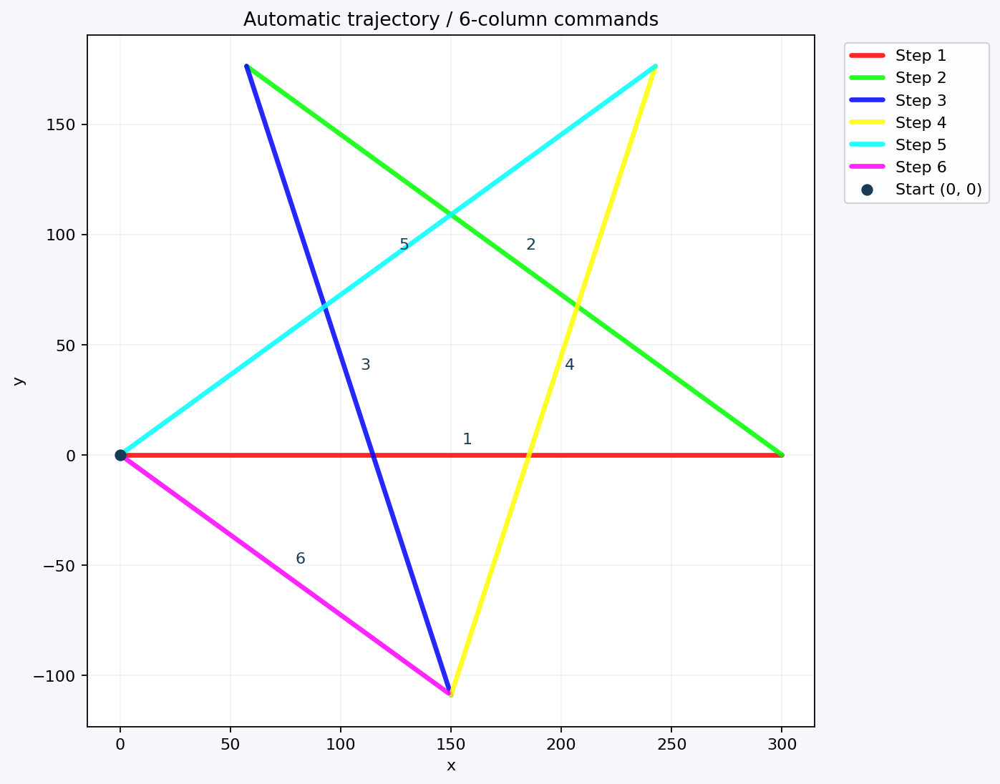
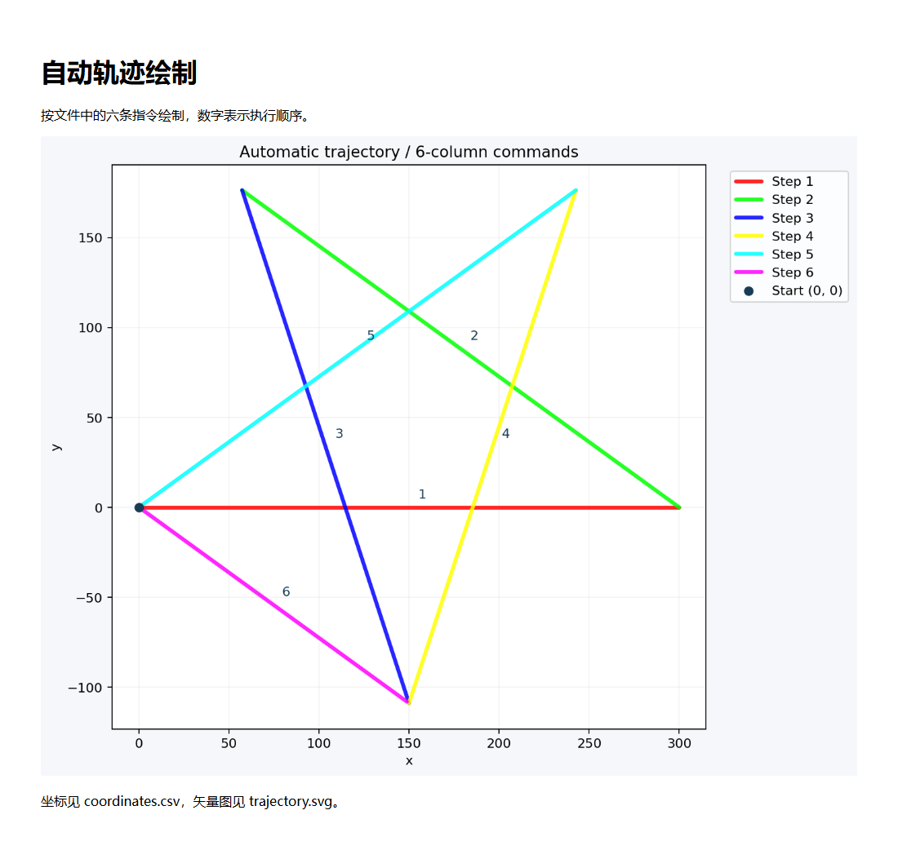

# 自动轨迹绘制实验

本仓库对应课程作业 **09_自动轨迹绘制**。

[查看原始题目](<originals/微信图片_20261120232541_129890_12.jpg>)

## 单独下载后的运行方式

在本仓库目录打开终端，使用 Python 3.10 或以上：

```powershell
python -m venv .venv
.\.venv\Scripts\Activate.ps1
python -m pip install -r requirements.txt
python main.py
```

若 PowerShell 不允许激活，可用 `.\.venv\Scripts\python.exe` 替代后续命令中的 `python`。

运行测试：`python -m pytest tests -v`。成果在 outputs，截图在 screenshots。HTML 是本地预览文件，下载后打开即可。

当前入口已按基础练习简化：先看 `main.py` 的 `load_commands()` 和 `draw_turtle()`，重点是读取每行数字，再设置颜色、前进，用 if/else 判断左右转。图片与坐标导出放在 `preview.py`，避免与海龟绘图混在一起。此次简化由 AI 协助完成，保留了原数据和运行命令，便于自己手敲和对照理解。

根据课堂照片中的六行数据，编写程序读取 CSV 自动绘制彩色轨迹，输出 PNG、SVG、坐标数据与实际验证记录。原始图片见 [归档题目](originals/微信图片_20261120232541_129890_12.jpg)。

## 数据与约定

照片没有完整字段说明，本实现按常见自动轨迹绘制格式解释为：`距离,转向类型,角度,红,绿,蓝`。约定转向类型 0 为左转、1 为右转，初始位置 `(0,0)`、朝右；每行先设颜色并前进，再转向。绘出的颜色顺序和星形轨迹与图片中的彩色部分相符。

逐行录入 [data/trajectory.csv](data/trajectory.csv)，没有把第一列 184 擅自改为更规整的长度。文件可有表头，也支持与照片相同的无表头六列数据。

| 步骤 | 距离 | 转向 | 角度 | RGB |
| --- | ---: | ---: | ---: | --- |
| 1 | 300 | 0 | 144 | 1,0,0 红 |
| 2 | 300 | 0 | 144 | 0,1,0 绿 |
| 3 | 300 | 0 | 144 | 0,0,1 蓝 |
| 4 | 300 | 0 | 144 | 1,1,0 黄 |
| 5 | 300 | 0 | 108 | 0,1,1 青 |
| 6 | 184 | 0 | 72 | 1,0,1 紫 |

照片还展示了额外的黑色外轮廓，但可见的六条指令只描述上述彩色线段，故未补造未提供的黑线指令。前五段构成封闭五角星，第六段从起点向下方顶点方向前进，因原长 184 与精确五边形边长有差异而略有间隙，这不是累计计算错误。

## 运行

本机 Python 3.9.12，Matplotlib 用于静态导出。在本仓库目录运行下面的命令。也可在本目录运行：

```powershell
python main.py
python main.py --input data/trajectory.csv --output outputs/custom
python main.py --turtle
python -m pytest tests -v
```

`--turtle` 额外打开标准库海龟窗口，绘制后单击关闭，需要 Python 的 Tk 图形支持。静态生成不打开窗口。

## 原理与源码

[main.py](main.py) 的 `load_commands()` 检查六列、有限数、距离范围、方向 0/1、角度范围和 RGB 0～1。辅助文件 [preview.py](preview.py) 中的 `trace()` 维护位置与朝向：

```text
end_x = x + distance × cos(heading)
end_y = y + distance × sin(heading)
新朝向 = (原朝向 ± angle) mod 360
```

数学计算先将角度转为弧度，左转加角度，右转减角度。`export()` 使用实际段坐标画图，`draw_turtle()` 用同样的原始指令调用 forward/left/right。读取、计算、绘图分开，便于定位字段或转向错误。

## 成果与验证

实际执行 6 条指令，总长度 1684，最终朝向 36°。前五段终点回到原点，存在正常的约 1e-13 浮点舍入误差，测试使用容差比较。

- [预览页](outputs/preview.html)：轨迹与分步坐标。
- [轨迹图片](outputs/trajectory.png) 与 [SVG](outputs/trajectory.svg)。
- `outputs/coordinates.csv`、`segments.json`：每步起终点、原始距离、颜色及转前转后方向。
- [验证记录](outputs/verification.html)：实际生成与 10 项测试，覆盖照片数据、封闭性质、段长、右转、无表头输入、空文件、非法参数及海龟先前进再转向的调用顺序。





实验说明了如何将数据解释、几何状态更新和图形呈现分离。需要新增外框等图形时，应补充明确的原始指令，再由同一读取和绘制流程执行。
